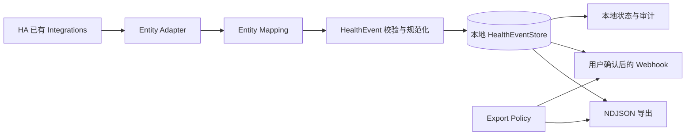

# OpenHealthRouter

OpenHealthRouter 是一个本地优先的健康数据路由层。它复用 Home Assistant 已有的设备接入能力，把普通实体状态转换为带有来源、时间精度、质量和证据信息的 `HealthEvent`，保存到本地健康事件库，再由用户决定导出到哪里。

它不是一个新的设备接入平台，也不是医疗诊断系统。

> **项目状态：设计阶段。** 当前仓库只有初始文档，尚无可安装的集成、数据库或服务。本文描述的是首版设计，不代表功能已经实现。

## 为什么基于 Home Assistant

大量血压计、体脂秤、睡眠设备和环境传感器已经可以通过 Home Assistant Integration、ESPHome、MQTT 或 BLE 接入。OpenHealthRouter 不重复实现这些协议，而是补充 Home Assistant 通用状态模型没有完整表达的健康语义：

- 测量时间及其精度，而不只是实体最后变化时间；
- 测量者、设备、来源集成和原生记录 ID；
- 原始观察、厂商推算和用户修正之间的区别；
- 单位、测量上下文、质量问题和证据链；
- 按目标、指标、时间范围和数据层级控制导出；
- 去重、修正、删除和导出审计。

Home Assistant 继续负责设备接入、实体、展示和自动化；OpenHealthRouter 负责健康事件的治理与路由。

## 架构概览



第一条可验证链路是：

```text
米家体脂秤
  → 现有 HA 集成提供 sensor.weight 等实体
  → OpenHealthRouter 实体映射
  → body.weight / body.fat_percentage HealthEvent
  → 本地事件库
  → 用户选择范围并导出 NDJSON 或 Webhook
```

体脂秤的体重可以作为设备观察保存；体脂率、BMI 等必须标记为厂商或映射器推算值，不能伪装成直接测量。

## 首版范围

首版以 **Home Assistant custom integration** 为唯一必需组件：

1. 通过 Config Flow 配置映射，不要求用户修改 YAML。
2. 订阅用户明确选择的 HA 实体，不扫描或接管其他集成。
3. 将数值、单位、时间、来源和质量信息规范化为 `HealthEvent`。
4. 使用本地 SQLite 保存事件，支持幂等写入、修正链、查询和删除。
5. 保留 HA Recorder 无法长期表达的原始属性和健康语义。
6. 支持用户主动触发 NDJSON 文件导出和 Webhook 导出。
7. 导出前按目标、指标、时间范围和是否包含原始属性进行过滤，并记录不含健康值的审计信息。
8. 默认不进行后台持续外发；失败后保留本地事件，由用户明确重试。

首版从启用映射后开始记录，不把 HA Recorder 历史自动回填为精确健康测量。

## 暂不做

- 重新实现小米云、BLE、MQTT 等设备协议；
- 强制部署独立 Add-on、容器或第二台服务器；
- 将 HA Recorder 当作唯一健康数据库；
- 自动诊断、治疗建议或由大模型生成医学阈值；
- 默认把健康数据发送给云端 AI；
- 首版内置 MCP、FHIR、完整 REST API、多人权限系统或自动同步规则；
- 把 `last_changed` 无条件冒充真实测量时间。

这些能力可以在核心链路验证后按需增加，不属于当前交付承诺。

## 与相关项目的关系

- **HealthTracker**：后续作为移动端 Capture / Bridge / Consent Client，负责手工录入、OCR、HealthKit / Health Connect 和用户确认；不要求它直接适配多个 AI 服务。
- **bmc-e6-ha**：继续作为独立 HA 设备集成，后续通过适配器输出统一事件。`recordNo` 仅作为设备内原生 ID，不能成为全局事件 ID。
- **外部 AI / MCP / FHIR / Webhook**：都是可替换消费者，不直接读取 SQLite 或 HA 内部状态。

## 规划中的仓库结构

以下结构是实现时的方向，不是当前已存在的代码：

```text
OpenHealthRouter/
├── custom_components/
│   └── openhealthrouter/   # HA Integration、映射、存储与导出
├── contracts/            # HealthEvent schema、指标定义和 golden vectors
├── docs/
└── addon/                # 仅在未来确有独立部署需求时加入
```

## 完全 AI 编码

本项目计划完全由 AI 编写实现、测试、迁移和文档。技术栈以 HA 原生 Python、Pydantic、SQLite 和可执行契约为基础，采用 OpenSpec 规格驱动、小任务实现、自动质量门禁和独立 AI Review；人负责需求、高风险变更和发布审批。详见[技术栈与 AI 编码工作流](docs/technology-stack.md)。

## 文档

- [总体架构](docs/architecture.md)
- [技术栈与 AI 编码工作流](docs/technology-stack.md)
- [分期实施计划](docs/roadmap.md)
- [HealthEvent 模型](docs/health-event.md)
- [HA 实体映射](docs/entity-mapping.md)
- [隐私与安全](docs/privacy.md)

## 参考资料

- [Home Assistant 核心架构](https://contributors.home-assistant.io/architecture/core/)
- [Home Assistant 历史与 Recorder](https://contributors.home-assistant.io/architecture/core/history/)
- [Home Assistant Config Flow](https://developers.home-assistant.io/docs/config_entries_config_flow_handler)
- [Xiaomi BLE 集成](https://www.home-assistant.io/integrations/xiaomi_ble)
- [FHIR R4 Observation](https://hl7.org/fhir/R4/observation.html) 与 [Provenance](https://hl7.org/fhir/R4/provenance.html)：作为外部互操作参考，不直接作为内部存储模型。

## 免责声明

OpenHealthRouter 用于个人健康数据整理与互操作，不是医疗器械，不提供诊断或治疗建议。数据异常、设备故障或导出问题不应被解释为医学结论。
