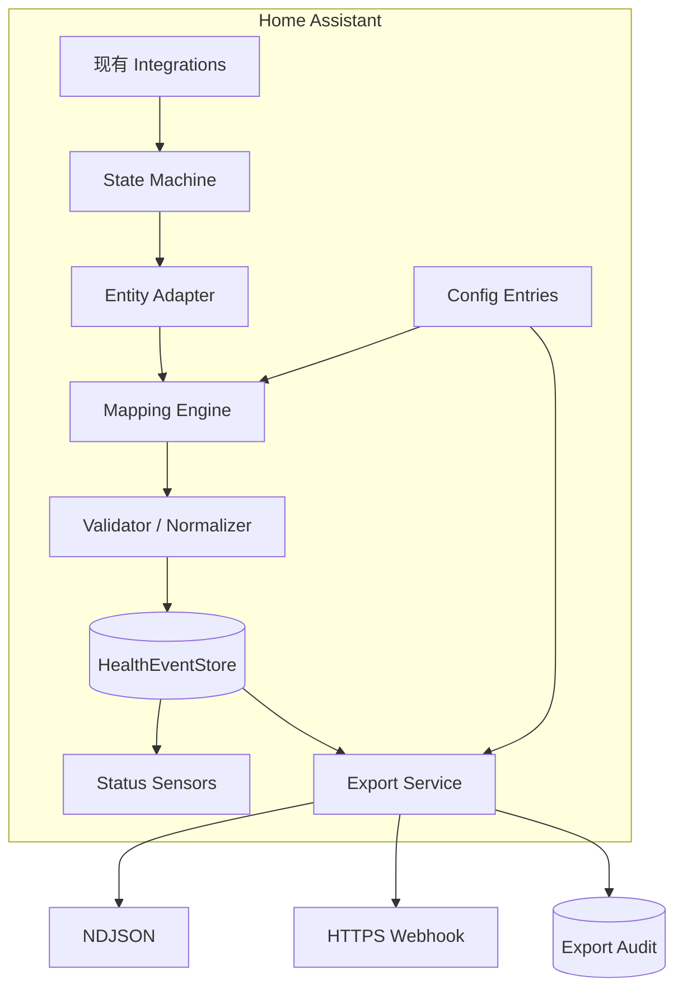

# 总体架构

## 1. 核心决策

OpenHealthRouter 首版是一个 Home Assistant custom integration。它复用 HA 的连接器和运行环境，不重新实现设备协议，也不要求独立 Add-on。

系统分成两个数据平面：

| 平面 | 负责内容 | 不负责内容 |
| --- | --- | --- |
| HA Entity Plane | 设备接入、最新状态、Dashboard、家庭自动化 | 完整健康证据、长期原始健康事实 |
| Health Plane | `HealthEvent`、去重、修正、质量、权限过滤、导出和审计 | 设备配网、厂商协议、医疗诊断 |

HA Entity 是输入和可选投影，不是唯一事实源。HA Recorder 的保留策略也不能替代健康事件的生命周期管理。

## 2. 组件

### Entity Adapter

只订阅映射中列出的 `state_changed` 事件，并排除 OpenHealthRouter 自己创建的实体，避免递归摄入。其他 HA 实体保持只读。

### Mapping Engine

把 `entity_id + state + attributes + device metadata` 转换为候选健康事件。映射必须声明指标、取值位置、单位、测量者、时间来源和数据性质。

### Validator / Normalizer

负责结构化校验、单位转换、时间表达、来源和质量标记。它不做医学诊断，也不使用大模型猜测缺失值。

无法安全解析的输入应被拒绝并显示原因；不能把 `unknown`、`unavailable` 或空字符串写成健康测量。

### HealthEventStore

首版使用 SQLite，建议路径由 HA API 生成：`hass.config.path("openhealthrouter", "events.db")`。不直接读写 HA 的 `.storage` 内部文件。

存储职责：

- 以 `eventId` 幂等写入；
- 保存规范事件及必要原始属性；
- 为测量者、指标、时间和来源建立索引；
- 以新事件表达修正，不覆盖旧事件；
- 支持本地查询、用户删除和数据库迁移；
- 默认不因条数或 HA Recorder 保留期静默删除健康事件。

配置和映射使用 HA Config Entries；Webhook 密钥使用 HA 支持的凭据存储方式，不写入事件或日志。

### Export Service

导出是本地事件库之上的显式操作。请求至少包含目标、指标集合、时间范围和数据层级。默认只导出规范事件，不包含原始属性、设备标识或备注。

NDJSON 与 Webhook 共用同一个过滤和序列化路径，避免不同出口出现不同的数据口径。首版 Webhook 由用户确认后触发；失败只记录投递状态，不回滚已经保存的健康事件，也不伪报成功。自动后台重试留到确有需求后实现。

## 3. 写入流程

1. 收到已配置实体的状态变化。
2. 忽略自身投影及 `unknown`、`unavailable` 等无效状态。
3. 按映射提取数值、单位、原生 ID、时间和测量者。
4. 校验并生成规范 `HealthEvent`；缺失语义以质量问题表达，不编造。
5. 生成稳定 `eventId` 并写入 SQLite。
6. 重复 `eventId` 返回重复结果，不重复计数。
7. 提交成功后更新数据源状态和最近接入时间。
8. 只有在用户配置并确认后，才进入导出流程。

SQLite 提交失败时不能更新接入成功状态，也不能向发送方确认已持久化。

## 4. 时间与去重

`recordedAt` 是 OpenHealthRouter 收到数据的时间；`observedAt` 是测量时间，两者必须分开。

优先级如下：

1. 来源提供的真实测量起止时间；
2. 来源提供的日期级测量时间；
3. HA 状态时间，仅作为带质量问题标记的近似值。

只有日期时保留日期和 `precision: day`，不能补成中午 12 点。只有 HA `last_changed` 时，必须记录 `observed_time_from_ha_state`，因为状态变化可能来自重启、刷新或属性变化。

原生记录 ID 存在时，事件身份由来源、设备、原生 ID 和指标共同确定。不存在时，使用规范内容的稳定散列，并接受一个限制：HA 只提供最新状态时，完全相同且未引起状态变化的重复测量可能无法被观测。

## 5. 修正、派生与删除

- **原始观察**：设备或用户直接提供的测量。
- **厂商派生**：体脂率、BMI、云端评分等由设备或厂商算法生成的结果，标记为 `derived.vendor`。
- **用户修正**：创建新事件并通过 `correctionOf` 指向原事件；默认查询采用最新有效版本，原事件仍可追溯。
- **用户删除**：删除请求优先于逻辑不可变性。事件内容、原始属性及关联证据按删除流程移除，审计只保留必要操作元数据。

## 6. 首版对外边界

首版只提供 HA 内部的配置、查询和导出能力，不启动独立 REST 服务。后续接入 HealthTracker 或独立连接器时，再增加经过认证的批量摄入 API；需要独立部署时，再评估 Add-on。

bmc-e6-ha 的适配应保留 `recordNo`、真实时间精度和来源。云端评分与设备测量必须成为不同事件，不能混入同一个原始观察。

## 7. 运维与备份

- 数据库、映射和必要证据必须纳入 HA 备份说明；升级前执行可恢复备份。
- 数据库迁移必须可测试，失败时不得启动半可用写入流程。
- 状态实体只暴露接入状态、最近事件时间和导出结果，不复制整套健康仪表盘。
- 日志记录实体 ID、错误类别和关联 ID；默认不记录健康值、完整事件、密钥或 Webhook 请求体。
- 首版不引入 Redis、Celery、PostgreSQL 或常驻云账号体系。

## 8. 首版验收链路

1. 小米体脂秤经现有 HA 集成产生体重实体。
2. 映射生成单位为 kg、`source.kind = ha_entity` 的体重事件。
3. 体脂率事件同时带有 `derived.vendor` 和 `estimated` 质量信息。
4. 同一状态事件重复投递只保存一次；重启不重新摄入整段 Recorder 历史。
5. 本地查询可以按指标和时间返回事件及质量问题。
6. 用户导出最近 7 天 NDJSON，文件只包含所选指标。
7. Webhook 不可用时事件仍保留，界面显示失败且允许用户重试。
8. 默认配置下没有任何自动外部网络投递。
